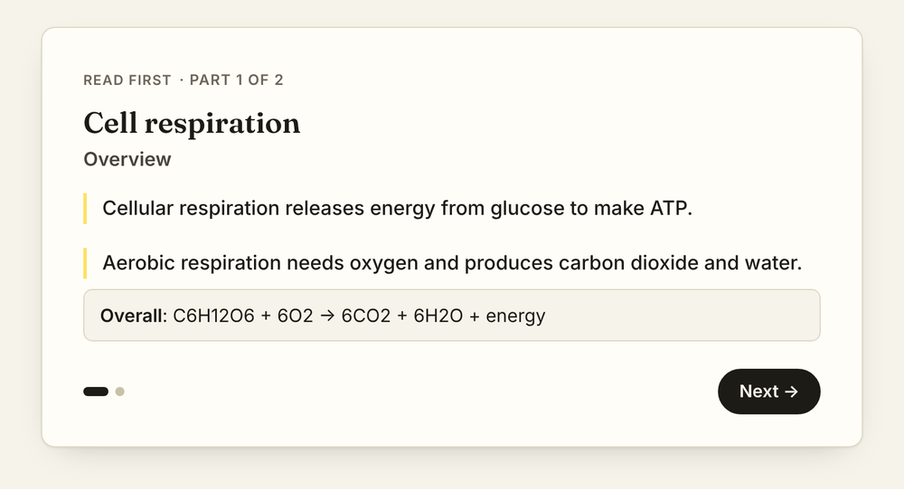
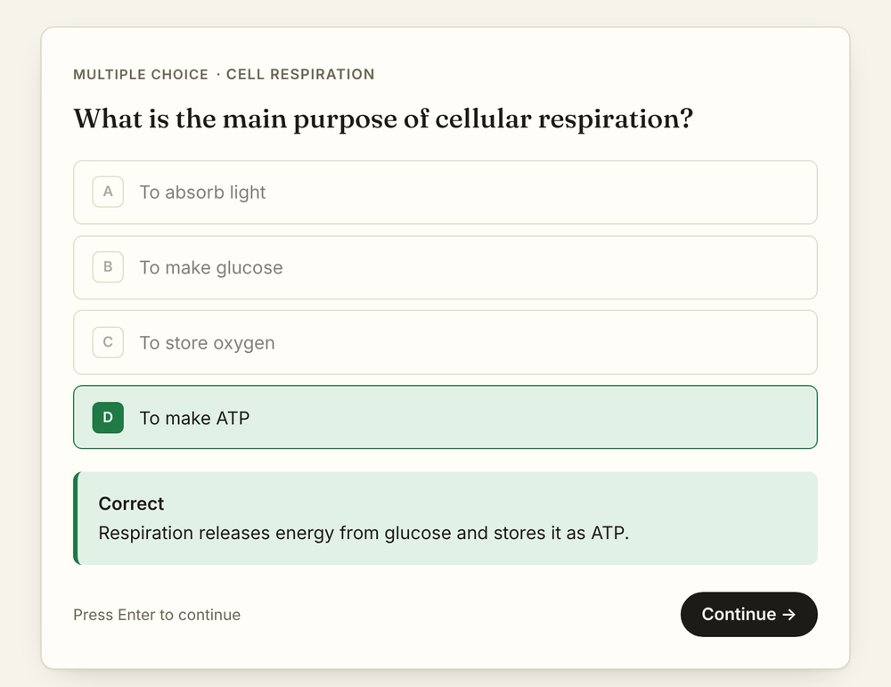

# QuizlyNotes

**Turn your notes, PDFs and lecture slides into revision notes, practice quizzes and flashcards.**

Live at [quizlynotes.com](https://quizlynotes.com).

    

| | |
|---|---|
|  |  |
| Revision notes made from a lecture | A practice quiz on those notes |

## What it does

- **Reads your material.** Upload a PDF, Word document, PowerPoint or text file, or paste text in. Gemini reads the whole PDF, including diagrams and scanned slides.
- **Writes revision notes.** Short pages of bullet points with the key terms in bold, which you can edit, simplify or improve.
- **Makes practice quizzes.** Covers every section of your notes, with 10 question types (multiple choice, true/false, fill in the blank, matching, ordering, odd one out and more) and an explanation for every answer.
- **Marks fairly.** Typed answers are accepted with small typos, plurals and missing "the"s, and there's an "I was right" button for when it gets it wrong.
- **Makes flashcards.** Flip cards with spaced repetition (Again / Hard / Good / Easy), plus Match, Speed and Write games.
- **Keeps track.** Scores for each set, a review of the questions you missed, and a "retry missed" button.
- **Free and Pro plans.** Studying is always free. The paid plan raises the AI limits and adds mock exams and weak-spot drills. See [`MONETISATION.md`](MONETISATION.md).

## How you use it

1. **Sign in** with Google, or try it from the home page without an account.
2. **Add your notes:** upload a file or paste text, and pick a subject.
3. **Read the notes** it writes, and edit anything you want to change.
4. **Take the quiz,** then go back over the questions you missed.
5. **Revise with flashcards.** Cards you find hard come back sooner.

## Getting started

```bash
git clone https://github.com/joeFerguson3/Flashcard-generator.git
cd Flashcard-generator
python -m venv .venv
.venv\Scripts\activate             # macOS/Linux: source .venv/bin/activate
pip install -r requirements-dev.txt
copy .env.example .env             # macOS/Linux: cp .env.example .env
flask --app wsgi run --debug       # opens on http://localhost:5000
```

You don't need any API keys to try it locally. In `.env`, set `AI_PROVIDER=fake` to use sample data instead of Gemini, and `ENABLE_DEV_LOGIN=true` to sign in at <http://localhost:5000/dev-login> without Google. Leave `DATABASE_URL` blank to use a local SQLite file.

To run the tests:

```bash
pytest
```

## Settings

Every option is in [`.env.example`](.env.example). The main ones:

| Variable | What it does |
|---|---|
| `DATABASE_URL` | Postgres connection string. Required in production. |
| `GEMINI_API_KEY` | Your key from [Google AI Studio](https://aistudio.google.com/apikey). |
| `GEMINI_MODEL` / `GEMINI_FAST_MODEL` | Which Gemini models to use. The fast one runs the guest demo and "Improve". |
| `GENERATION_LIMIT` / `GUEST_LIMIT` | How many sets a user or guest can make per hour and per day. |
| `ENABLE_GUEST_DEMO` | Shows the "try it" box on the home page. |
| `MONETISATION_ENABLED` | Turns the Free / Pro plans and Stripe payments on or off. |

## Deploying

The site runs on Google Cloud Run with a free [Neon](https://neon.tech) Postgres database.

1. **Database:** create a Neon project near your Cloud Run region (e.g. `europe-west2` → AWS London) and copy its connection string. Tables are created automatically on each deploy.
2. **Gemini:** create an API key and **turn on billing** for its project. On the free tier Google may use the uploads to improve its products, and the limits are low.
3. **Deploy:**

```bash
gcloud run deploy quizlynotes --source . --region europe-west2 \
  --timeout 300 --memory 1Gi \
  --set-env-vars APP_ENV=production,SITE_URL=https://quizlynotes.com,GEMINI_MODEL=gemini-3.8-flash \
  --set-secrets FLASK_SECRET_KEY=flask-secret:latest,DATABASE_URL=database-url:latest,GEMINI_API_KEY=gemini-key:latest,GOOGLE_CLIENT_ID=google-client-id:latest,GOOGLE_CLIENT_SECRET=google-client-secret:latest
```

Keep `--timeout 300`, because a long PDF can take a minute or two to process.

4. **After deploying:** submit `https://quizlynotes.com/sitemap.xml` in Google Search Console.

## Project files

### `quizlynotes/`

| File | What it does |
|---|---|
| `__init__.py` | Creates the Flask app and sets up the database, login, rate limits and security headers. |
| `config.py` | Reads the settings from `.env`. |
| `models.py` | The database tables: users, study sets, note sections, quiz questions and flashcards, quiz attempts and usage. |
| `auth.py` | Google sign-in and the local dev login. |
| `billing.py` | Free and Pro plan limits, Stripe payments, trials and referrals. |
| `sanitize.py` | Cleans user input and AI output before it's saved or shown. |
| `activity.py` | Records usage for the stats page. |
| `seo.py` | The text and FAQs for the landing pages. |

### `quizlynotes/ai/`

| File | What it does |
|---|---|
| `extract.py` | Turns uploaded files into something the model can read. |
| `prompts.py` | The instructions sent to Gemini for notes, quizzes and flashcards. |
| `schemas.py` | The exact JSON shape the model has to reply in. |
| `validate.py` | Checks every reply, e.g. that the right answer is one of the options. |
| `providers.py` | Talks to Gemini, with a backup model if it's busy and an offline fake for testing. |

### `quizlynotes/services/` and `quizlynotes/views/`

| File | What it does |
|---|---|
| `services/study.py` | Creating and updating sets, scoring quizzes and scheduling flashcards. |
| `views/public.py` | The home page, landing pages, pricing and the guest demo. |
| `views/study.py` | The app pages: library, notes, quizzes, flashcards and settings. |
| `views/api.py` | The JSON endpoints the pages call. |
| `views/billing.py` | Checkout and the Stripe webhook. |
| `views/admin.py` | The owner-only stats pages. |

### Everything else

| Folder | What's in it |
|---|---|
| `quizlynotes/templates/` | The HTML pages: `public/` for the website, `app/` for the app, `partials/` for shared pieces. |
| `quizlynotes/static/` | The CSS, one small JavaScript file per page (no build step), icons and screenshots. |
| `migrations/` | Database changes. After editing `models.py`, run `flask --app wsgi db migrate -m "what changed"` and commit the new file. |
| `tests/` | Tests for the app and billing. They use the fake AI, so they run offline. |

## Built with

Python, Flask, SQLAlchemy, PostgreSQL (Neon), Google Gemini, Stripe, and a plain HTML/CSS/JavaScript front end, hosted on Google Cloud Run.
